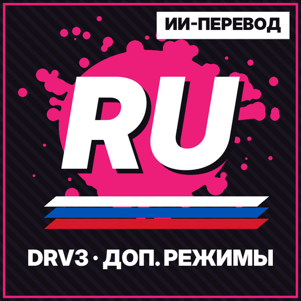
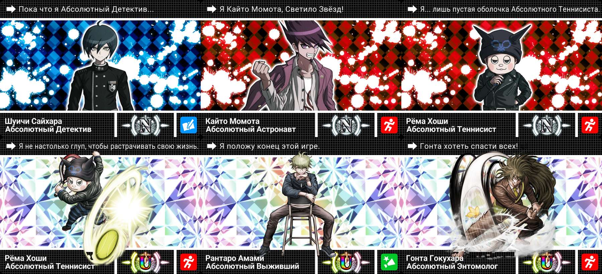
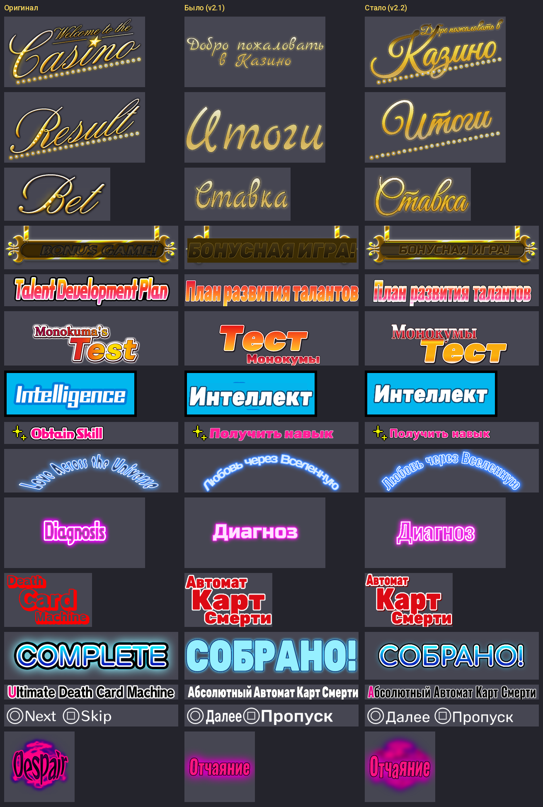

# Русификатор дополнительных режимов Danganronpa V3: Killing Harmony

Неофициальный фанатский перевод **дополнительных режимов** Danganronpa V3: Killing Harmony (Steam, Windows) на русский язык.
Основной сюжет этот перевод не трогает.

> [!WARNING]
> **Перевод полностью нейросетевой.** Весь текст и надписи переведены нейросетью (Claude, Anthropic), профессиональный переводчик их не вычитывал.
> Возможны неточности, странные формулировки и ошибки в роде или обращениях. Если найдёте такое, сообщите (см. [«Нашли ошибку?»](#нашли-ошибку)).

**Текущая версия: 2.2** · [Скачать установщик](../../releases/latest) · [Руководство в Steam](https://steamcommunity.com/sharedfiles/filedetails/?id=3814734825)

## Что переведено

- **«Любовь через Вселенную» (Salmon Team)**: все сцены, «мысли» персонажей, концовки, интерфейс и таблички с именами.
- **«План развития Абсолютных Талантов»**: события всех 56 персонажей DR1, DR2 и V3, сцены дружбы, случайные события, экзамены, выпускной, меню, карты, навыки и имена.
- **«Подземелье Отчаяния» (Тест Монокумы)**: интерфейс, предметы, снаряжение, монстры, бой, сюжетные сцены и подписи эффектов.
- **Автомат Карт Смерти**: меню и все 159 Карт Смерти (цитаты, имена, таланты).
- **Казино**: меню, призы, слоты и Мономоно-автомат.
- **Графика и шрифты**: надписи на картинках перерисованы в стиле оригинала, в шрифт диалогов и шрифт мини-игр добавлена кириллица.

## Установка

**Основной русификатор не нужен.** Если он уже стоит, перевод встанет поверх него.

1. Скачайте `DRV3_Rus_Extra_Setup_v2.2.zip` из [Releases](../../releases/latest) и распакуйте архив.
2. Закройте игру.
3. Запустите `DRV3_Rus_Extra_Setup_v2.2.exe` и нажимайте «Далее». Папка игры в Steam определяется сама. Если этого не произошло, укажите папку, где лежит `Dangan3Win.exe`.
4. Дождитесь конца установки (от нескольких секунд до пары минут) и запускайте игру.

Если Windows покажет «Система Windows защитила ваш компьютер», нажмите «Подробнее» → «Выполнить в любом случае». У установщика нет цифровой подписи, с фанатскими русификаторами так бывает часто.

**Требования:**
- Steam-версия игры для Windows. Anniversary Edition (файлы `.arc` вместо `.cpk`) не подходит.
- Если основного русификатора нет, нужно около **10,5 ГБ** свободного места на диске с игрой. Установщик сам это проверит и ничего не тронет, если места не хватает.

### Как это работает

- **Чистая игра из Steam.** Пока архивы `partition_data_win_us.cpk` и `partition_resident_win.cpk` лежат в `data\win`, игра читает файлы только из них, а любая правка самих архивов ломает загрузку. Поэтому установщик распаковывает файлы этих архивов в `data\win`, накладывает перевод и шрифт с кириллицей, а сами архивы переносит в папку `_rus_extra_backup` (это мгновенно, без копирования). Доп. режимы будут на русском, основная игра останется на английском.
- **Основной русификатор уже установлен.** Перевод доп. режимов ставится поверх него, лишнее место не нужно.
- Все действия пишутся в журнал `_rus_extra_backup\installed.txt`. Если установка прервётся, всё откатится автоматически.

### Удаление

Удалить перевод можно двумя способами: «Параметры Windows → Приложения → Русификатор доп. режимов Danganronpa V3 → Удалить» или запустить `_rus_extra_backup\Uninstall_RusExtra.exe` в папке игры. Игра вернётся в исходное состояние.

Если Steam обновит игру или вы запустите «Проверку целостности файлов», перевод слетит. В этом случае просто запустите установщик ещё раз.

Полная инструкция с разделом «Если игра не запускается» лежит в [docs/ПРОЧИТАЙ_МЕНЯ.txt](docs/ПРОЧИТАЙ_МЕНЯ.txt).

## Что осталось на английском

- Логотипы: Salmon Team, обложки игр серии на автомате, MONOMONO SLOT.
- Анимированные надписи из отдельных букв: DAY, AUTO, BONUS GAME.
- Надписи внутри мини-игр казино (TIME, SCORE, COMBO!, GET!! и т. п.) и ранги (AAA, S…).
- Обучающие картинки-скриншоты в Плане развития.
- Финальные титры.

## Нашли ошибку?

Пришлите скриншот и укажите режим. Можно завести [issue](../../issues) или написать автору в Steam: https://steamcommunity.com/id/lolikovski/

## Для разработчиков

В репозитории лежат исходники перевода и инструменты сборки. **Файлов игры здесь нет**: оригиналы извлекаются из вашей собственной копии игры.

| Папка | Что внутри |
|---|---|
| `work/tr/` | Перевод Salmon Team (`индекс<TAB>русский текст`) |
| `work/rtr/` | Перевод Плана развития и Подземелья Отчаяния |
| `work/cards_ru.tsv` | Тексты Карт Смерти |
| `work/rtm.tsv`, `work/tm_new.tsv` | Память переводов |
| `work/STYLE_rsc.md` | Руководство переводчика: обращения, род, имена, ограничения шрифта |
| `work/fonts*/` | Свободные шрифты для надписей (см. [work/FONTS.md](work/FONTS.md)) |
| `tools/` | Python-инструменты: разбор CPK/SPC/STX/SRD, текстуры (`texedit.py`, `tex_specs.py`), шрифты, Карты Смерти, сборка патчей и установщика |
| `installer/` | Установщик: `install.ps1` + `cpklib.cs` (распаковка CPK, патчи DRVP) + `setup.nsi` (NSIS) |
| `tests/` | Тесты установщика на синтетической «игре» (`run_tests.py`, нужен `pwsh`) |
| `experiments/` | Скрипты опытов со способом распаковки |

Кратко о сборке (Python 3, Pillow, etcpak, NSIS):

1. Извлеките оригинальные файлы доп. режимов из `partition_data_win_us.cpk` и `partition_resident_win.cpk` с помощью `tools/cpk.py` в папку `orig/`.
2. Строковые выгрузки `work/src/` и `work/rsrc/` создаются заново скриптами `tools/prep.py` и `tools/prep_rsc.py`.
3. Соберите переведённые файлы (`tools/build_*.py`), патчи (`tools/mkdelta.py` → `pkg/payload`) и установщик: `python3 tools/build_setup.py 2.2 <папка_вывода>`.

## Авторы

- Автор сборки: **lolik-lolikov** — https://steamcommunity.com/id/lolikovski/
- Перевод текста и надписей, сборка шрифтов и установщик: нейросеть Claude (Anthropic). Перевод полностью нейросетевой.

Danganronpa V3: Killing Harmony © Spike Chunsoft. Перевод фанатский и некоммерческий, с правообладателями не связан.
