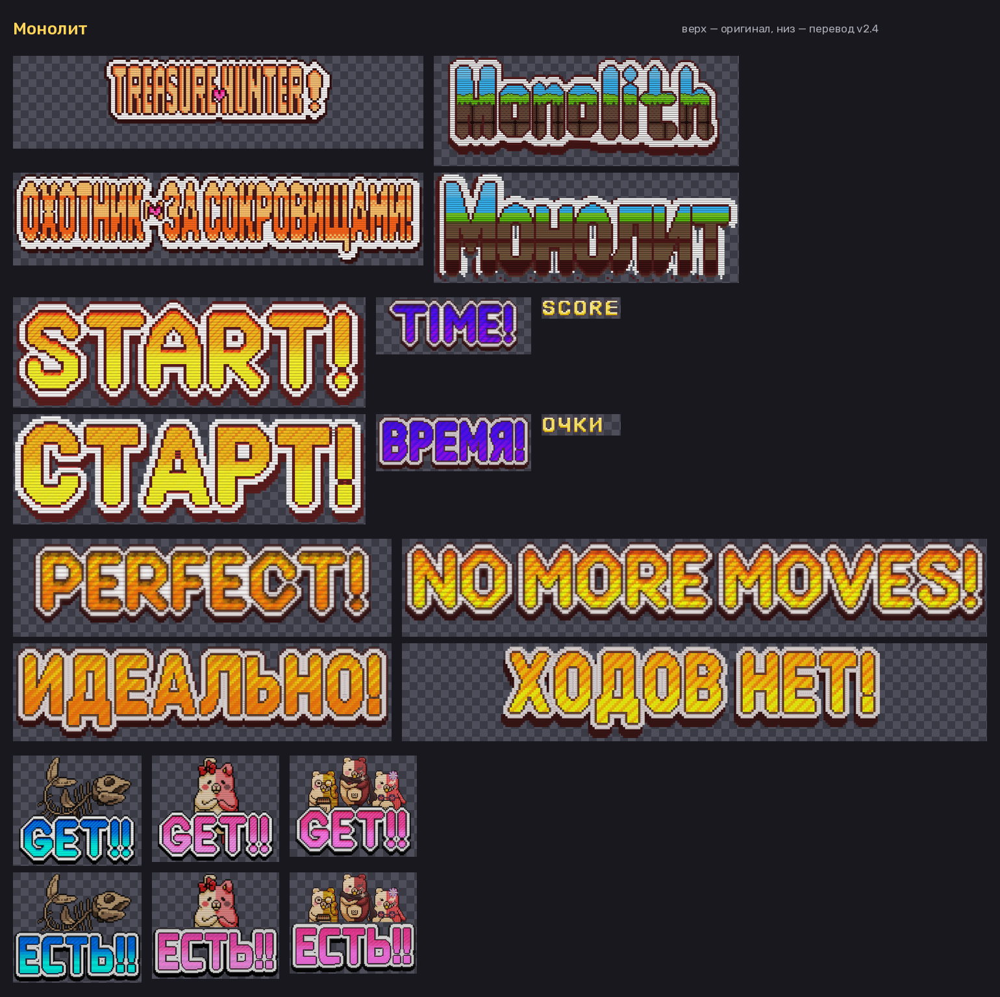
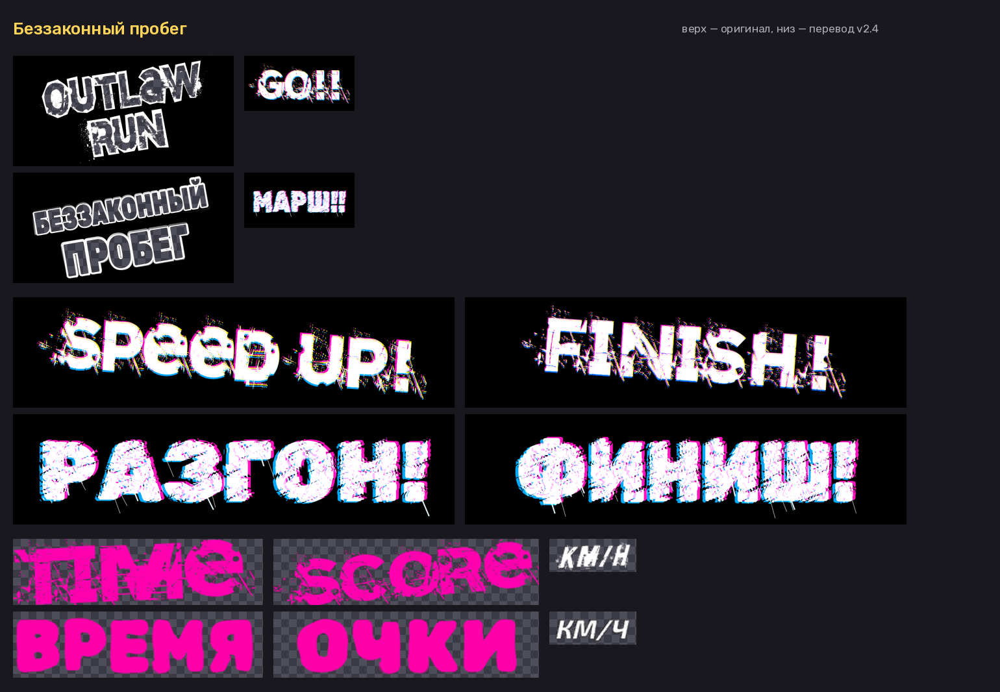

# Русификатор дополнительных режимов Danganronpa V3: Killing Harmony

Неофициальный фанатский перевод **дополнительных режимов** Danganronpa V3: Killing Harmony (Steam, Windows) на русский язык.
Основной сюжет этот перевод не трогает.

> [!WARNING]
> **Перевод полностью нейросетевой.** Весь текст и надписи переведены нейросетью (Claude, Anthropic), профессиональный переводчик их не вычитывал.
> Возможны неточности, странные формулировки и ошибки в роде или обращениях. Если найдёте такое, сообщите (см. [«Нашли ошибку?»](#нашли-ошибку)).

**Текущая версия: 2.4** · [Скачать установщик](../../releases/latest) · [Руководство в Steam](https://steamcommunity.com/sharedfiles/filedetails/?id=3814734825)

## Скачать

Архив `DRV3_Rus_Extra_Setup_v2.4.zip` (~16,6 МБ, внутри установщик и инструкция). Файлы по всем ссылкам одинаковые:

- [GitHub Releases](../../releases/latest)
- [Google Диск](https://drive.google.com/file/d/14m6HkanG1EQIW32jaNluqtHK9KCuAbKO/view?usp=sharing)
- [Яндекс Диск](https://disk.yandex.ru/d/FJ-wmYaYEN-QUA)

SHA-256 архива: `a76bca3cc3c3921f3e9c3299787b2cc78f0343c73258ed84bb007edceb5c0616`

## Что нового в 2.4

**Картинки.** Переведены надписи, которые раньше оставались на английском, а все переведённые картинки заново сверены с оригиналом.

- Мини-игры казино «Ловля лосося», «Беззаконный пробег» и «Монолит»: ВРЕМЯ, ОЧКИ, КОМБО!, ЕСТЬ!, МИМО!, СТАРТ!, ФИНИШ!, ИДЕАЛЬНО!, ХОДОВ НЕТ! и другие, включая пиксельные надписи «Монолита».
- Надписи из отдельных букв-спрайтов: ДЕНЬ, АВТО, ИДЁМ!, БОНУС ИГРА! в слотах, неон МОНОКУМА в «Любовном тесте», МОНОМОНО на Мономоно-автомате, «Шанс повтора».
- НОВОЕ, УР (уровень), заголовки и должности в титрах «Подземелья Отчаяния», подсказка «Быстрый ход» для клавиатуры AZERTY, «БОНУСНАЯ ИГРА!» и «Подробно» в автомате слотов.
- Шрифты, цвета, размеры и украшения ещё ближе к оригиналу; исправлены обрезанные края (имена, месяцы, годы, курсы); у подписей эффектов сохранено облако оригинала; «Пробуждение!» — кистевым шрифтом, как «Awaken».
- Карты Смерти: таланты приведены к спискам (Лидер Байкеров, Менеджер, Абсолютная Фотограф, Абсолютный Киллер у U-карты Маки).

**Текст (правки версии 2.3, отдельно она не выкладывалась).** Исправлено около 1450 строк:

- «Любовь через Вселенную»: в сценах, доставшихся от основного русификатора, исправлены опечатки, ошибки в роде, пунктуация, кальки, латинские буквы внутри русских слов, кавычки и пропущенная «ё».
- «План развития» и «Подземелье Отчаяния»: таланты и имена в списках приведены к тем же формам, что в диалогах; исправлены названия предметов и эффектов.
- Переносы строк больше не оставляют одинокие «в», «с», «и» в конце строки; «!?» → «?!».

## Что переведено

- **«Любовь через Вселенную» (Salmon Team)**: все сцены, «мысли» персонажей, концовки, интерфейс и таблички с именами.
- **«План развития Абсолютных Талантов»**: события всех 56 персонажей DR1, DR2 и V3, сцены дружбы, случайные события, экзамены, выпускной, меню, карты, навыки и имена.
- **«Подземелье Отчаяния» (Тест Монокумы)**: интерфейс, предметы, снаряжение, монстры, бой, сюжетные сцены, подписи эффектов и титры.
- **Автомат Карт Смерти**: меню и все 159 Карт Смерти (цитаты, имена, таланты).
- **Казино**: меню, призы, слоты, Мономоно-автомат и все три мини-игры.
- **Графика и шрифты**: надписи на картинках перерисованы в стиле оригинала, в шрифт диалогов и шрифт мини-игр добавлена кириллица.

## Установка

**Основной русификатор не нужен.** Если он уже стоит, перевод встанет поверх него.

1. Скачайте `DRV3_Rus_Extra_Setup_v2.4.zip` (см. [«Скачать»](#скачать)) и распакуйте архив.
2. Закройте игру.
3. Запустите `DRV3_Rus_Extra_Setup_v2.4.exe` и нажимайте «Далее». Папка игры в Steam определяется сама. Если этого не произошло, укажите папку, где лежит `Dangan3Win.exe`.
4. Дождитесь конца установки (от нескольких секунд до пары минут) и запускайте игру.

Обновление с 2.2: просто запустите новый установщик поверх, удалять старую версию не нужно.

Если Windows покажет «Система Windows защитила ваш компьютер», нажмите «Подробнее» → «Выполнить в любом случае». У установщика нет цифровой подписи, с фанатскими русификаторами так бывает часто.

**Требования:**
- Steam-версия игры для Windows. Anniversary Edition (файлы `.arc` вместо `.cpk`) не подходит.
- Если основного русификатора нет, нужно около **10,5 ГБ** свободного места на диске с игрой. Установщик сам это проверит и ничего не тронет, если места не хватает.

### Как это работает

- **Чистая игра из Steam.** Пока архивы `partition_data_win_us.cpk` и `partition_resident_win.cpk` лежат в `data\win`, игра читает файлы только из них, а любая правка самих архивов ломает загрузку. Поэтому установщик распаковывает файлы этих архивов в `data\win`, накладывает перевод и шрифт с кириллицей, а сами архивы переносит в папку `_rus_extra_backup` (это мгновенно, без копирования). Доп. режимы будут на русском, основная игра останется на английском.
- **Основной русификатор уже установлен.** Перевод доп. режимов ставится поверх него, лишнее место не нужно.
- Все действия пишутся в журнал `_rus_extra_backup\installed.txt`. Если установка прервётся, всё откатится автоматически.

### Удаление

Удалить перевод можно двумя способами: «Параметры Windows → Приложения → Русификатор доп. режимов Danganronpa V3 → Удалить» или запустить `_rus_extra_backup\Uninstall_RusExtra.exe` в папке игры. Игра вернётся в исходное состояние.

Если Steam обновит игру или вы запустите «Проверку целостности файлов», перевод слетит. В этом случае просто запустите установщик ещё раз.

Полная инструкция с разделом «Если игра не запускается» лежит в [docs/ПРОЧИТАЙ_МЕНЯ.txt](docs/ПРОЧИТАЙ_МЕНЯ.txt).

## Что осталось на английском

Оставлено как в оригинале намеренно:

- логотипы: DANGAN SALMON TEAM, неоновая вывеска MONOMONO SLOT над слотами, обложки игр серии на автомате;
- значки WILD/SCATTER и ранги казино (AAA, S…);
- обучающие картинки-скриншоты интерфейса в «Плане развития» и «Подземелье»;
- имена в титрах «Подземелья» (латиницей, как в оригинале).

## Нашли ошибку?

Пришлите скриншот и укажите режим. Можно завести [issue](../../issues) или написать автору в Steam: https://steamcommunity.com/id/lolikovski/

## Для разработчиков

В репозитории лежат исходники перевода и инструменты сборки. **Файлов игры здесь нет**: оригиналы извлекаются из вашей собственной копии игры.

| Папка | Что внутри |
|---|---|
| `work/tr/` | Перевод Salmon Team (`индекс<TAB>русский текст`) |
| `work/tr_main/` | Правки (с 2.3) поверх текста основного русификатора в сценах Salmon Team; применяет `tools/build_ainori.py` |
| `work/rtr/` | Перевод Плана развития и Подземелья Отчаяния |
| `work/cards_ru.tsv` | Тексты Карт Смерти |
| `work/rtm.tsv`, `work/tm_new.tsv` | Память переводов |
| `work/STYLE_rsc.md` | Руководство переводчика: обращения, род, имена, ограничения шрифта |
| `work/tex/index.json` | Список текстур доп. режимов |
| `work/fonts*/` | Свободные шрифты для надписей (см. [work/FONTS.md](work/FONTS.md)) |
| `tools/` | Python-инструменты: разбор CPK/SPC/STX/SRD, текстуры (`texedit.py`, `tex_specs.py`, `lutfx.py`, `pixword.py`, `pixglyph.py`, `squarefont.py`, `neonfx.py`, `fxcustom.py`), шрифты, Карты Смерти, сборка патчей и установщика |
| `audit/` | Проверка картинок: поиск непереведённых текстур (`scan.py`), проверка краёв (`edgecheck.py`), листы сравнения (`compare_build.py`, `showcase.py`), проверка патчей на оригиналах (`apply_payload.py`) |
| `installer/` | Установщик: `install.ps1` + `cpklib.cs` (распаковка CPK, патчи DRVP) + `setup.nsi` (NSIS) |
| `tests/` | Тесты установщика на синтетической «игре» (`run_tests.py`, нужен `pwsh`) |
| `experiments/` | Скрипты опытов со способом распаковки |

Кратко о сборке (Python 3, Pillow, etcpak, NSIS):

1. Извлеките оригинальные файлы доп. режимов из `partition_data_win_us.cpk` и `partition_resident_win.cpk` с помощью `tools/cpk.py` в папку `orig/`.
2. Строковые выгрузки `work/src/` и `work/rsrc/` создаются заново скриптами `tools/prep.py` и `tools/prep_rsc.py`.
3. Соберите переведённые файлы: текст — `tools/build_*.py`, текстуры — `tools/build_tex.py` (или `tools/build_arch.py <архив>`), Карты Смерти — `tools/cards.py`.
4. Соберите патчи (`tools/mkdelta.py` → `pkg/payload`) и установщик: `python3 tools/build_setup.py 2.4 <папка_вывода>`.

## История версий

- **2.4** — переведены все оставшиеся надписи на картинках (мини-игры казино, буквы-спрайты, НОВОЕ/УР, титры), картинки сверены с оригиналом; вычитка текста (около 1450 исправленных строк).
- **2.2** — работает без основного русификатора; надписи на картинках переделаны в стиле оригинала; переведены все 159 Карт Смерти.
- **1.0–1.2** — первые версии; требовался основной русификатор.

## Авторы

- Автор сборки: **lolik-lolikov** — https://steamcommunity.com/id/lolikovski/
- Перевод текста и надписей, сборка шрифтов и установщик: нейросеть Claude (Anthropic). Перевод полностью нейросетевой.

Danganronpa V3: Killing Harmony © Spike Chunsoft. Перевод фанатский и некоммерческий, с правообладателями не связан.
